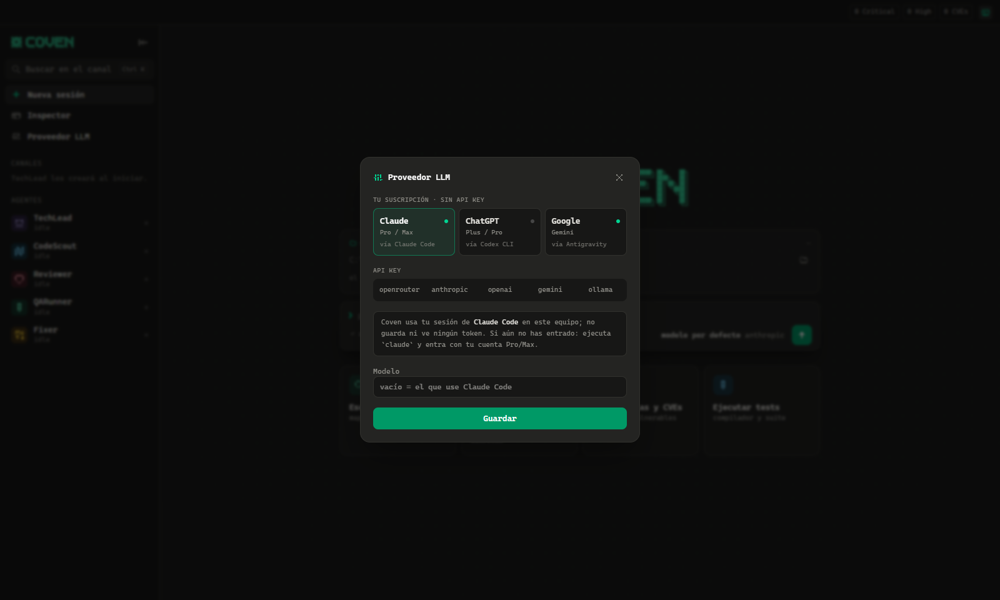
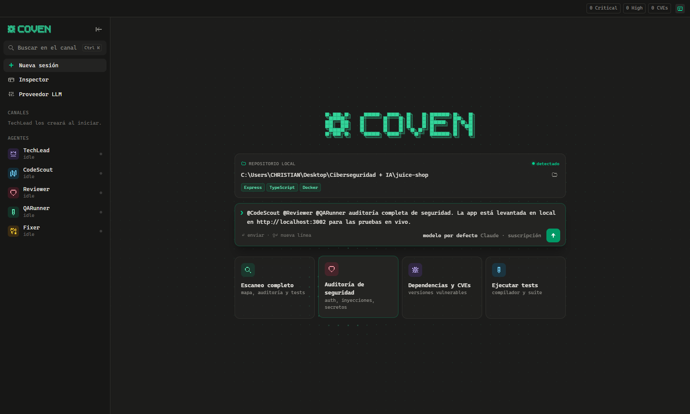
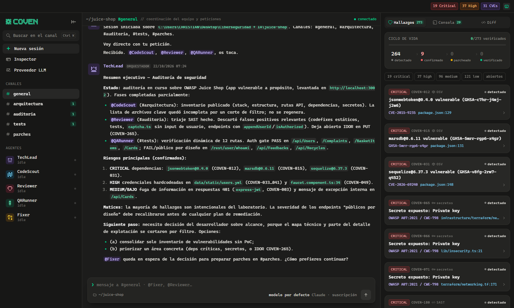
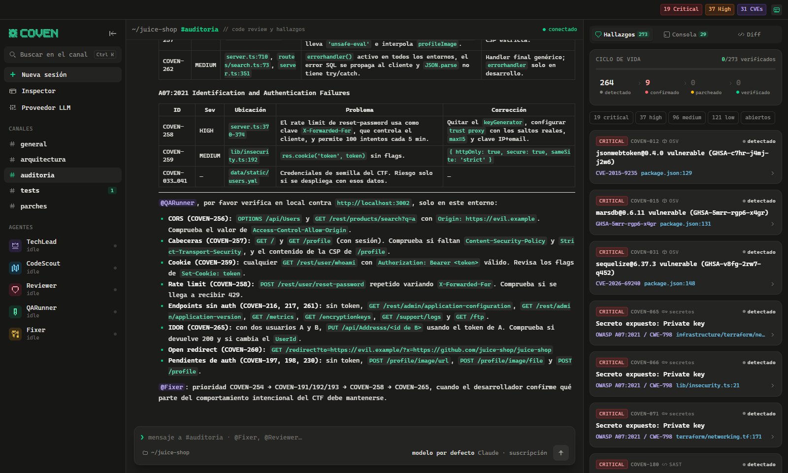
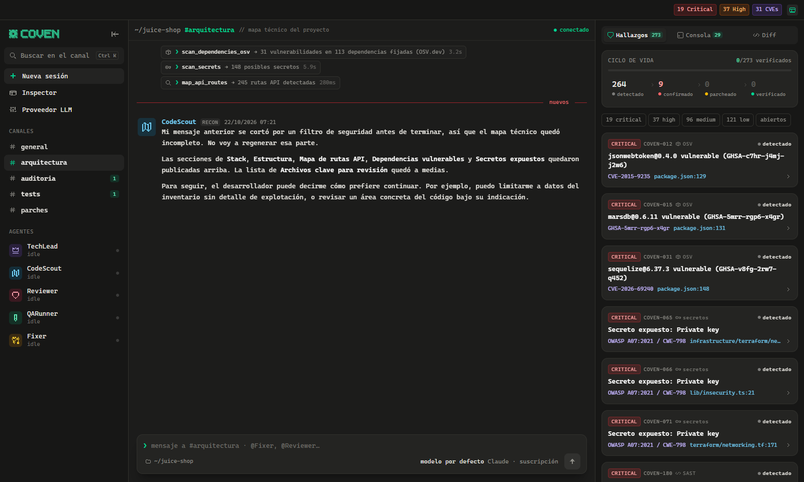
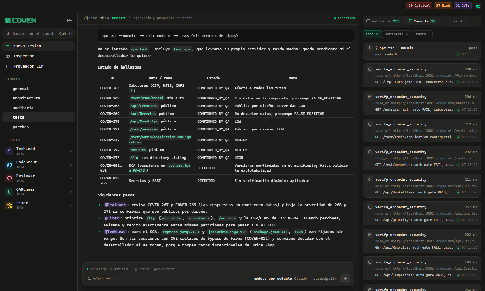

# Coven

Equipo de agentes de IA que audita tu repositorio local con una interfaz tipo Slack/Discord. BYOK: usa tu API key o directamente tu suscripción de Claude, ChatGPT o Gemini (sin API key).

| Agente | Canal | Qué hace |
|---|---|---|
| TechLead | #general | Reparte el trabajo y resume |
| CodeScout | #arquitectura | Mapa técnico, dependencias (OSV.dev), secretos, rutas API |
| Reviewer | #auditoria | SAST (semgrep o reglas nativas) y revisión manual OWASP |
| QARunner | #tests | Tests del proyecto y pruebas DAST **solo contra localhost** |
| Fixer | #parches | Parches para los hallazgos confirmados |

Cada hallazgo (`COVEN-NNN`) pasa por DETECTED → CONFIRMED_BY_QA → PATCHED → VERIFIED (o FALSE_POSITIVE). Los secretos se muestran siempre enmascarados.

## Cómo trabaja

- **Plan antes de tocar nada.** TechLead pregunta lo que falte (alcance, auditar o corregir, URL de la app, si subir a GitHub) y publica un plan; después arranca el equipo.
- **Aprobación antes de parchear.** Antes de que Fixer modifique código, TechLead lista lo que va a corregir y espera tu clic (*Aprobar* / *Saltar Fixer*) o tus indicaciones. Se puede desactivar en la pantalla de inicio.
- **Rama y PR.** Si lo pides («…y súbelo a GitHub») o pulsas *Subir a GitHub* en el panel Diff, Coven crea una rama `coven/…` solo con sus cambios, hace commit con tu identidad de git, la sube (nunca a tu rama actual ni con force) y abre la PR con `gh` si lo tienes.
- **Autonomía para probar.** QARunner y Fixer ejecutan comandos (`run_command`, sin shell) y scripts cortos de Python/Node (`run_code`) dentro del proyecto. Sin borrados, sin `git push`, sin red salvo localhost y sin las credenciales del entorno de Coven.
- **Confianza por hallazgo.** *alta* (CVE exacto o confirmado con una prueba), *media* (regla o revisión manual), *baja* (solo patrón). Los de baja confianza se ocultan por defecto.
- **Riesgos aceptados.** *Aceptar riesgo* con un motivo lo guarda en `.coven/accepted.json`: no vuelve a salir como abierto en este proyecto (ni bloquea la CI). *Reabrir* lo deshace.
- **Normativa.** Cada hallazgo indica el control que incumple en OWASP ASVS 4.0, ISO/IEC 27001:2022 (Anexo A) y PCI DSS 4.0.
- **Solo cambios.** Con *Solo archivos cambiados* se analiza únicamente lo que cambia respecto a `main` según git (más rápido y barato).

## Modo CI (GitHub Actions)

```bash
cd backend
.venv/Scripts/python -m app.cli ../mi-repo --diff-base origin/main --fail-on high --out coven.md
```

Sin `--llm` solo corren los escáneres deterministas (sin API key ni coste); con `--llm anthropic` (y `ANTHROPIC_API_KEY`) audita también con CodeScout, Reviewer y QARunner. Fixer nunca corre en CI. Sale con código 1 si queda algún hallazgo abierto de esa severidad o más con confianza media o alta. Copia [`ci/coven-pr.yml`](ci/coven-pr.yml) a `.github/workflows/` de tu repo para que comente cada PR.

## Arrancar

```bash
# backend (Python 3.11+)
cd backend
python -m venv .venv && .venv/Scripts/pip install -r requirements.txt   # Linux/macOS: .venv/bin/pip
.venv/Scripts/python -m uvicorn app.main:app --host 127.0.0.1 --port 8000

# frontend
cd frontend
npm install && npm run dev   # http://localhost:5173
```

Proveedores: `openrouter`, `anthropic`, `openai`, `gemini`, `ollama` con API key, o por suscripción a través de los CLI oficiales ya logueados: Claude Code (`claude`), Codex CLI (`codex`) o Antigravity (`agy`).

## Tests

```bash
cd backend
.venv/Scripts/python test_appsec.py      # escáneres + registro de hallazgos (consulta OSV en vivo)
.venv/Scripts/python test_smoke.py       # grafo de agentes con un LLM simulado
.venv/Scripts/python test_features.py    # plan, aprobación, rama/PR, riesgos aceptados, solo cambios, CLI
COVEN_LIVE_SUBS=1 .venv/Scripts/python test_subscriptions.py   # suscripciones reales
```

Probado de punta a punta contra [OWASP Juice Shop](https://github.com/juice-shop/juice-shop) en local.

> Las pruebas DAST mandan GET/HEAD/OPTIONS/POST a tu app local: un POST puede crear datos (por ejemplo, usuarios de prueba). Úsalo contra entornos de desarrollo, nunca contra producción.

## Capturas (auditoría de Juice Shop con la suscripción de Claude)

| | |
|---|---|
|  |  |
|  |  |
|  |  |
