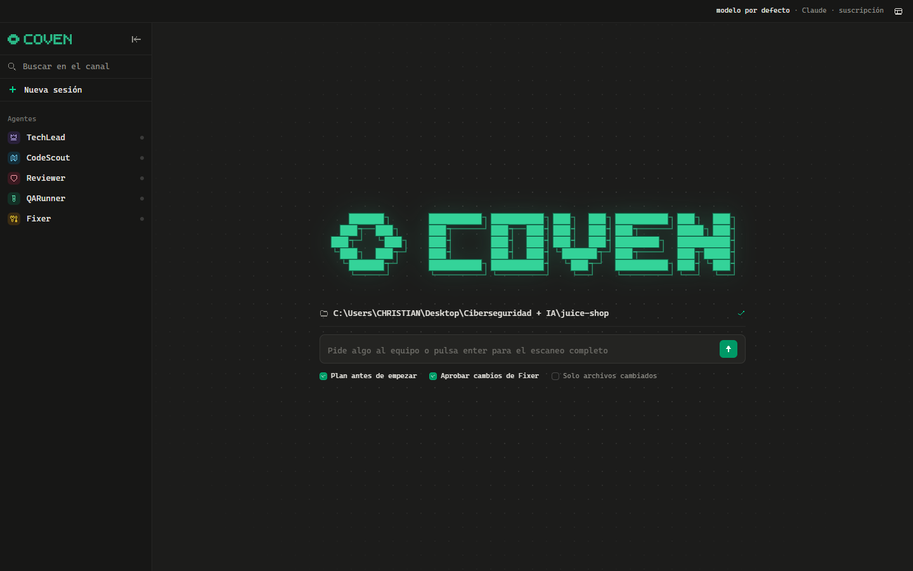
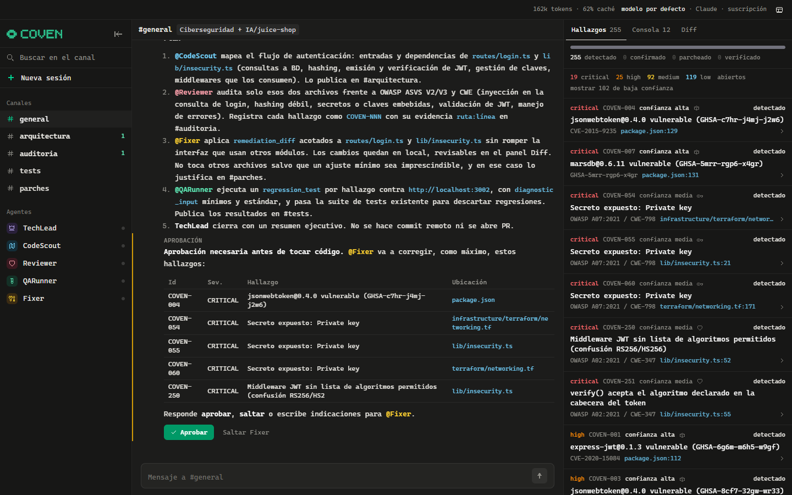
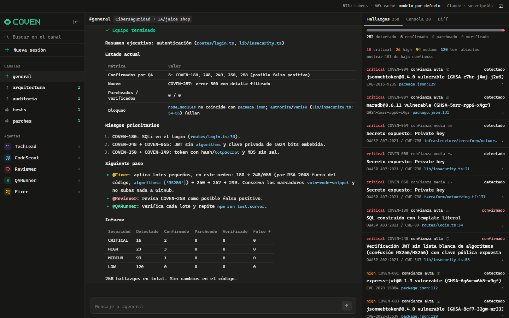
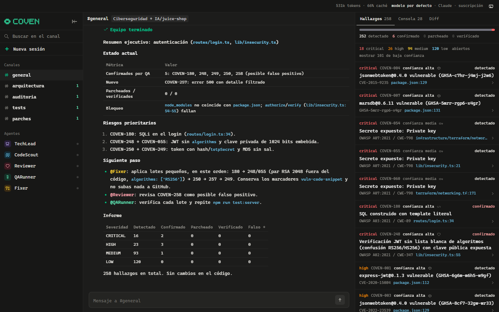

<p align="center">
  
</p>

<p align="center">
  <b>Un equipo de agentes de IA que audita, prueba y corrige la seguridad de tu código.</b><br>
  App de escritorio · BYOK o tu suscripción de Claude / ChatGPT / Gemini · todo en local
</p>

<p align="center">
  <a href="../../releases/latest"></a>
  
  
</p>

<p align="center">
  
</p>

Coven abre tu repositorio en una interfaz tipo Slack/Discord donde cinco agentes trabajan en sus propios canales. Les pides algo en lenguaje natural («audita el login y corrige lo crítico») y TechLead te hace preguntas si le falta algo, publica un plan, reparte el trabajo y te pide permiso antes de tocar una sola línea.

| Agente | Canal | Qué hace |
|---|---|---|
| **TechLead** | #general | Pregunta, planifica, reparte el trabajo, pide aprobación y resume |
| **CodeScout** | #arquitectura | Mapa técnico, dependencias vulnerables (OSV.dev), secretos, rutas API |
| **Reviewer** | #auditoria | SAST (semgrep o reglas nativas) y revisión manual guiada por OWASP |
| **QARunner** | #tests | Ejecuta los tests y verifica endpoints **solo contra localhost** |
| **Fixer** | #parches | Parchea lo confirmado y comprueba su propio cambio |

## Capturas

| | |
|---|---|
|  |  |
| **Plan y aprobación.** TechLead acota el alcance, reparte el trabajo y no se toca nada hasta que pulsas *Aprobar*. | **Informe.** Resumen final con riesgos prioritarios, siguiente paso y estado de cada hallazgo. |
|  |  |
| **Hallazgos.** Severidad, confianza y controles ASVS / ISO 27001 / PCI DSS; filtro de ruido. | **Canales.** Cada agente trabaja y explica en el suyo. |
|  |  |
| **Mapa técnico.** Stack, dependencias vulnerables, secretos y rutas API. | **Consola.** Cada comando y herramienta que ejecutan los agentes, con su salida. |

## Instalar

Descarga el instalador de tu sistema en [**Releases**](../../releases/latest):

| Sistema | Archivo |
|---|---|
| Windows | `Coven_x.y.z_x64-setup.exe` (o `.msi`) |
| macOS | `Coven_x.y.z_*.dmg` |
| Linux | `.AppImage`, `.deb` o `.rpm` |

La app trae el backend dentro: no hace falta instalar Python. Al abrirla, elige el proveedor:

- **Suscripción (sin API key):** si tienes [Claude Code](https://claude.com/claude-code) (`claude`), Codex CLI (`codex`) o Antigravity (`agy`) instalado y con la sesión iniciada, Coven lo usa directamente. Coven no ve ni guarda tus tokens.
- **API key:** OpenRouter, Anthropic, OpenAI, Gemini u Ollama (local). La clave solo vive en la memoria de la sesión.

> Los instaladores no están firmados todavía: Windows SmartScreen pedirá *Más información → Ejecutar de todos modos*, y en macOS hay que abrirla con clic derecho → *Abrir* la primera vez.

## Cómo trabaja

- **Plan antes de tocar nada.** TechLead pregunta lo que falte (alcance, auditar o corregir, URL de la app, si subir a GitHub) y publica un plan; después arranca el equipo.
- **Aprobación antes de parchear.** Antes de que Fixer modifique código, TechLead lista lo que va a corregir y espera tu clic (*Aprobar* / *Saltar Fixer*) o tus indicaciones. Se puede desactivar en la pantalla de inicio.
- **Ciclo de vida de cada hallazgo.** `COVEN-NNN` pasa por DETECTED → CONFIRMED_BY_QA → PATCHED → VERIFIED (o FALSE_POSITIVE / riesgo aceptado). Los secretos se muestran siempre enmascarados y las claves privadas nunca se envían al modelo.
- **Rama y PR.** Si lo pides («…y súbelo a GitHub») o pulsas *Subir a GitHub* en el panel Diff, Coven crea una rama `coven/…` solo con sus cambios, hace commit con tu identidad de git, la sube (nunca a tu rama actual ni con force) y abre la PR con `gh` si lo tienes.
- **Autonomía para probar.** QARunner y Fixer ejecutan comandos (`run_command`, sin shell) y scripts cortos de Python/Node (`run_code`) dentro del proyecto. Sin borrados, sin `git push`, sin red salvo localhost y sin las credenciales del entorno.
- **Confianza por hallazgo.** *alta* (CVE exacto o confirmado con una prueba), *media* (regla o revisión manual), *baja* (solo patrón). Los de baja confianza se ocultan por defecto.
- **Riesgos aceptados.** *Aceptar riesgo* con un motivo lo guarda en `.coven/accepted.json`: no vuelve a salir como abierto en ese proyecto (ni bloquea la CI). *Reabrir* lo deshace.
- **Normativa.** Cada hallazgo indica el control que incumple en OWASP ASVS 4.0, ISO/IEC 27001:2022 (Anexo A) y PCI DSS 4.0.
- **Solo cambios.** Con *Solo archivos cambiados* se analiza únicamente lo que cambia respecto a `main` según git (más rápido y barato).
- **Sin cortes.** El trabajo de los agentes sigue en el backend aunque se caiga la conexión; la app se reconecta sola y recupera lo que se perdió.

> Las pruebas de endpoints mandan GET/HEAD/OPTIONS/POST a tu app local: un POST puede crear datos (por ejemplo, usuarios de prueba). Úsalo contra entornos de desarrollo, nunca contra producción.

## Modo CI (GitHub Actions)

```bash
cd backend
.venv/Scripts/python -m app.cli ../mi-repo --diff-base origin/main --fail-on high --out coven.md
```

Sin `--llm` solo corren los escáneres deterministas (sin API key ni coste); con `--llm anthropic` (y `ANTHROPIC_API_KEY`) audita también con CodeScout, Reviewer y QARunner. Fixer nunca corre en CI. Sale con código 1 si queda algún hallazgo abierto de esa severidad o más con confianza media o alta. Copia [`ci/coven-pr.yml`](ci/coven-pr.yml) a `.github/workflows/` de tu repo para que comente cada PR.

## Desarrollo

```bash
# backend (Python 3.11+)
cd backend
python -m venv .venv && .venv/Scripts/pip install -r requirements.txt   # Linux/macOS: .venv/bin/pip
.venv/Scripts/python -m uvicorn app.main:app --host 127.0.0.1 --port 8000

# frontend (navegador en http://localhost:5173, o la ventana de escritorio con `npm run tauri dev`)
cd frontend
npm install && npm run dev
```

**Compilar la app de escritorio** (necesita Rust y, en Windows, las Build Tools de Visual Studio):

```bash
cd backend && .venv/Scripts/pip install pyinstaller && .venv/Scripts/python build_sidecar.py
cd ../frontend && npm run tauri build
```

Las releases se generan solas: al subir un tag `v*`, [`.github/workflows/release.yml`](.github/workflows/release.yml) compila los instaladores de Windows, macOS y Linux y los adjunta a un borrador de release.

### Tests

```bash
cd backend
.venv/Scripts/python test_appsec.py      # escáneres + registro de hallazgos (consulta OSV en vivo)
.venv/Scripts/python test_smoke.py       # grafo de agentes con un LLM simulado, reconexión sin pérdidas
.venv/Scripts/python test_features.py    # plan, aprobación, rama/PR, riesgos aceptados, solo cambios, CLI
COVEN_LIVE_SUBS=1 .venv/Scripts/python test_subscriptions.py   # suscripciones reales
```

Probado de punta a punta contra [OWASP Juice Shop](https://github.com/juice-shop/juice-shop) en local con la suscripción de Claude.
